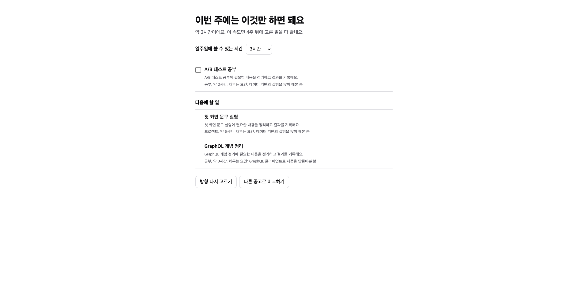
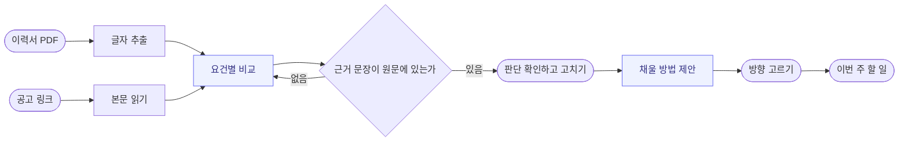

<p align="center"></p>

**잡맵은 이력서 PDF와 채용 공고 링크를 넣으면, 공고 요건별로 내 이력서의 근거를 대조하고 이번 주에 할 일을 정해 주는 AI 에이전트입니다.** 일주일에 3시간만 써도 무엇을 할지 고민하지 않고 이직을 준비할 수 있게 만드는 것이 목표입니다.

노마드코더 AX School의 Put AI to Work 챌린지에서 만들고 있는 개인 프로젝트이고, 지금은 로컬에서 실행하는 미완성 단계입니다. 잡맵은 임시 이름입니다.

## 목차 <!-- omit from toc -->

- [누구를 위한 에이전트인가요?](#누구를-위한-에이전트인가요)
- [어떤 업무를 대신하나요?](#어떤-업무를-대신하나요)
- [되는 것과 안 되는 것](#되는-것과-안-되는-것)
- [어떻게 돌아가나요?](#어떻게-돌아가나요)
- [왜 그렇게 정했나요?](#왜-그렇게-정했나요)
- [평가](#평가)
- [로컬 실행](#로컬-실행)
- [저장소 구조](#저장소-구조)

## 누구를 위한 에이전트인가요?

회사에 다니는 3년 차 프론트엔드 개발자입니다. 일은 잘하고 있지만 커리어를 고민할 시간이 거의 없고, 이직 생각이 들어 공고를 열어 봐도 모르는 기술에 불안해지다가 무엇부터 할지 정하지 못하고 창을 닫습니다. 실제 고객이 아니라 기획 단계에서 정한 가상 클라이언트입니다.

## 어떤 업무를 대신하나요?

**공고를 내 이력과 비교해 부족한 것을 찾고, 쓸 수 있는 시간에 맞춰 할 일을 정하는 일**을 대신합니다.

공고마다 요구 사항이 달라 무엇이 부족한지 판단하기 어렵고, 부족한 것이 여러 개면 순서를 정하지 못하는 단계가 가장 번거롭습니다. 잡맵은 비교와 제안을 맡고, 최종 판단은 사용자가 고칠 수 있게 남겨 둡니다.

## 되는 것과 안 되는 것

2026년 11월 10일 기준입니다.

**되는 것**

| 기능 | 확인한 방법 |
|:---|:---|
| 이력서 PDF에서 글자 추출 (2단 구성 포함) | 실제 2단 이력서 1건 |
| 공고 링크 읽기 (당근, 원티드, 점핏, Greenhouse, Lever, Ashby, Workday) | 플랫폼마다 실제 공고 1건, 배포 환경에서 측정 |
| 요건별 충족 판단과 근거 표시 | 가상 이력서로 실제 모델 실행. 원티드 공고로 화면에서 3회, 점핏과 Ashby, Lever 공고로 API에서 각 1회 저장 성공 |
| 판단을 쓰는 대로 하나씩 보여 주기 (스트리밍) | 배포 환경에서 원티드 공고로 첫 판단 9초, 전체 19초 |
| 모델이 든 근거 문장의 원문 대조 | 단위 테스트, 실제 모델이 지어낸 문장 차단 확인 |
| 판단 직접 수정, 새로 고침 뒤 복원 | 브라우저 |
| 단계마다 주소(`/runs/:id/...`)와 비교 기록 목록(`/history`) | 브라우저, 단위 테스트 |
| 고른 프로젝트를 이력서 문장(여러 방법을 한 프로젝트로 묶기 포함)으로 바꾸고, 들어갈 자리 확대, 이력서와 나란히 문장 확인, 할 일 체크, 결과 넣어 완성 |
| 할 일마다 날짜 적기, 달력, 전체 기간(몇 개월 몇 주) | 개발 서버(배포 API 연결)와 단위 테스트 | 실제 모델로 문장 생성 후 개발 서버(배포 API 연결)에서 끝까지 확인, 여러 쪽 PDF는 시드로만 확인 |
| 고른 방향을 이번 주 할 일로 나누기, 완료 체크 | 브라우저 (예시 데이터) |
| 입력 검증, 못 읽는 공고 안내 모달 | 단위 테스트, 브라우저 |

**아직 안 되거나 확인하지 못한 것**

- **부족한 요건을 채울 방법 제안:** 화면과 검증 코드는 있지만, Workers AI 무료 일일 한도를 소진해 실제 모델로는 성공을 확인하지 못했습니다.
- **실패 화면 구분:** 한도 소진 안내는 배포 환경의 실제 오류로 확인했고, 근거 실패와 연결 끊김은 단위 테스트만 했습니다.
- **판단이 맞는지:** 정답 데이터로 재지 않았습니다. 같은 입력에서 3번 중 1번은 판단 하나가 달라졌습니다.
- **링크로 못 읽는 공고:** 잡코리아, 사람인, 인크루트, 로켓펀치, 토스, 카카오, 쿠팡, LinkedIn은 본문을 붙여 넣어야 합니다.
- **스캔한 PDF:** 글자가 없어 붙여넣기로 안내합니다.
- **만들지 않은 것:** 확인 질문, GitHub 저장소로 완료 판정, 지식 기록(공부를 고른 방법).
- **배포:** Cloudflare Workers에 시험 배포했습니다. 서비스 전체 하루 총량 제한(비교 50회, 방향 제안 80회, 문장 80회)과 접속 주소별 하루 제한(비교 3회, 방향 제안 30회, 문장 30회)이 있습니다. 로그인은 없습니다. 진행 기록은 브라우저와 Worker에 저장됩니다.

## 어떻게 돌아가나요?



남색은 AI가 처리하는 단계이고, 나머지는 코드가 처리합니다. 판단과 설명은 모델이 맡고, 틀리면 안 되는 일(근거 대조, 시간 계산, 저장)은 코드가 맡습니다.

| 영역 | 사용 기술 |
|---|---|
| 에이전트 | TypeScript, Flue 2.3 |
| 서버 | Cloudflare Workers, Hono |
| 모델 | Workers AI `mistral-small-3.1-24b-instruct` |
| 화면 | React 19, Vite |
| PDF | pdfjs-dist (브라우저 안에서 추출) |
| 테스트 | Vitest, node:test |

모델은 무료 플랜에서 시험한 4개 중 도구 호출과 한국어 답이 모두 동작한 유일한 모델이라 골랐습니다. `kimi-k2.6`은 유료 전용이었고, `gpt-oss-120b`와 `llama-3.3-70b`는 도구 결과를 받은 뒤 두 번째 호출에서 오류가 났습니다.

## 왜 그렇게 정했나요?

개발 중 실제로 문제가 된 사례입니다. 수치는 함께 적은 시험에서 측정한 결과입니다. 전체 기록은 [판단 기록](docs/decision-log.md)에 있습니다.

### 1. 근거 문장은 모델을 믿지 않고 코드로 확인하기

> [!NOTE]
> **TL;DR**
>
> - **선택:** 모델이 든 공고 문장과 이력서 문장이 각자의 원문에 실제로 있는지 저장 전에 코드로 확인
> - **이유:** 비교 결과를 믿을 수 있으려면 근거가 입력에 있어야 함
> - **확인:** 공백 차이는 같은 문장으로 보고, 공고 문장을 이력서 근거로 쓰면 통과시키지 않음. 실제 모델이 저장에 실패하고도 "저장되었습니다"라고 답한 사례가 있어, 화면은 모델 문장이 아니라 도구 결과로 그림
> - **남은 일:** 문장이 원문에 있는 것과 판단이 맞는 것은 다른 문제라 정답 데이터로 따로 재야 함

### 2. 무료 모델의 한글 깨짐을 측정해서 우회하기

> [!NOTE]
> **TL;DR**
>
> - **문제:** 도구 호출에서 일부 한글이 `U+FFFD`로 깨져 와, 맞는 근거도 전부 실패로 처리됨
> - **측정:** 도구 호출을 강제한 8회에서 인자의 약 6%가 깨졌고, 스트리밍 여부와 상관없었음. 일반 답변 8회에서는 한 글자도 깨지지 않음
> - **선택:** 근거 문장은 원문에서 깨진 자리를 찾아 후보가 하나일 때만 복원. 새로 쓰는 문장은 도구 대신 일반 답변의 JSON으로 받고, 코드가 검증해 틀리면 최대 3번 호출
> - **포기한 것:** 유료 모델 전환. 비용 없이 시작하려고 미룸

### 3. 가상 공고에서 통과해도 실제 공고로 재기

> [!NOTE]
> **TL;DR**
>
> - **문제:** 요건 3개짜리 가상 공고는 통과했지만, 실제 공고 3건은 모델 응답이 출력 토큰 한도에서 잘려 모두 저장에 실패
> - **원인:** 프레임워크가 Workers AI에 출력 한도를 보내지 않아 기본값이 적용됨
> - **선택:** 모델 호출마다 출력 한도 4096토큰 지정
> - **확인:** 고친 뒤 점핏(한국어), Ashby와 Lever(영어) 공고 3건 모두 저장 성공

### 4. 공고 플랫폼은 실제 링크로 나누기

> [!NOTE]
> **TL;DR**
>
> - **측정:** 플랫폼 15곳의 실제 공고 1건씩을 읽어 9곳 성공, 6곳 실패. 결과는 [공고 링크 읽기 측정](docs/posting-sources.md)
> - **발견:** 잡코리아는 요약만, 원티드는 주요 업무만, 사람인은 메뉴 글만 읽고도 성공으로 처리되고 있었음
> - **선택:** 지원 요건이 없거나 500자 미만인 글은 실패로 처리. 사이트별 코드는 만들지 않고, 못 읽는 플랫폼은 입력 화면에서 붙여넣기로 안내
> - **배포 환경 재측정:** Cloudflare에서는 쿠팡과 LinkedIn이 추가로 실패해 7곳만 지원 목록에 남김

## 평가

| 지표 | 뜻 | 목표 | 현재 |
|:---|:---|:---:|:---:|
| 판단 일치율 | 요건별 판단이 사람이 정한 정답과 같은 비율 | 정하기 전 | 아직 안 잼 |
| 근거 통과율 | 근거 문장이 입력에 실제로 있는 비율 | 100% | 아직 안 잼 |
| 고친 판단 수 | 사용자가 공고 하나에서 직접 바꾼 판단 개수 | 공고 10개 중 8개 이상에서 2개 이하 | 아직 안 잼 |

당근 Frontend 공고 3개의 요건 29개로 잴 예정입니다. 정답은 에이전트 결과를 보기 전에 사람이 먼저 적습니다. 기준은 [평가 문서](docs/evaluation.md)에 있습니다.

## 로컬 실행

Node.js 24가 필요합니다. API 키는 쓰지 않고 Cloudflare 계정만 있으면 됩니다. 모델은 Cloudflare의 원격 자원을 쓰므로 `workers.dev` 서브도메인이 있어야 하고, 하루 무료 사용량을 넘으면 AI 기능이 실패합니다.

```sh
nvm use
npx wrangler login

# 터미널 1: 에이전트 서버 (5173)
cd agent && npm ci && npm run dev

# 터미널 2: 화면 (5174)
cd web && npm ci && npm run dev
```

http://localhost:5174 를 열면 됩니다. 테스트는 각 폴더에서 `npm test`로 실행합니다.

## 저장소 구조

| 경로 | 내용 |
|---|---|
| `agent/src/agents/` | Flue 에이전트 |
| `agent/src/tools/` | 비교 결과 저장 도구 |
| `agent/src/evidence/` | 근거 문장 대조와 복원 |
| `agent/src/posting/` | 공고 링크 읽기 |
| `agent/src/directions/` | 부족한 요건을 채울 방법 제안 |
| `agent/eval/postings/` | 평가용 공고 본문 |
| `web/src/app/` | 주소 구성, 비교 기록 저장과 목록 |
| `web/src/features/` | 단계별 화면과 판단 함수 (입력, 비교, 방향, 이번 주 할 일) |
| `web/src/shared/` | 여러 단계가 같이 쓰는 타입과 호출 |
| `docs/` | 판단 기록, 평가 기준, 플랫폼 측정 |

이력서와 정답 데이터는 개인 정보가 들어 있어 저장소에 올리지 않습니다.
